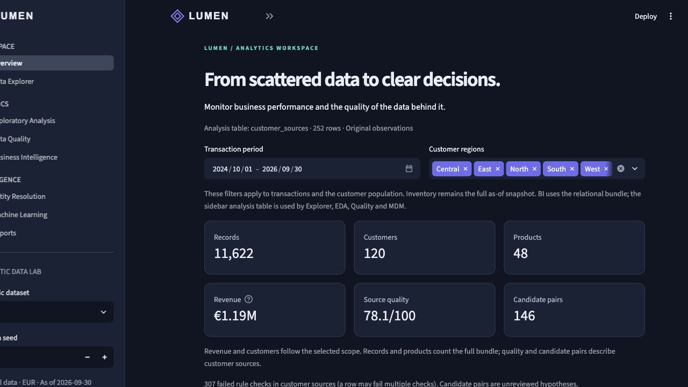
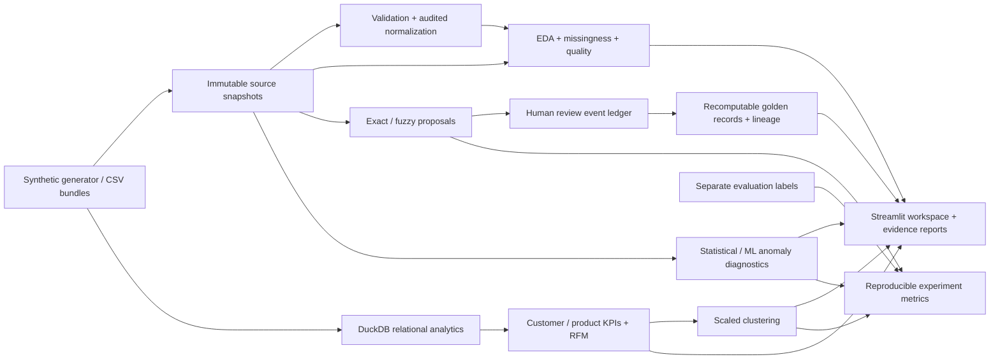

# Intelligent MDM & Analytics — Data Intelligence Platform

**Turn fragmented business data into evidence you can inspect, reproduce and explain.**

**v0.1.0 preparation:** locally audited and uploaded to a private repository with owner approval. GitHub-hosted CI is blocked before runner startup; no remote test pass is claimed. [Release audit](docs/RELEASE_AUDIT.md) · [Changelog](CHANGELOG.md) · [MIT license](LICENSE).

A local Python portfolio project for data analytics, data engineering and machine learning. The fictional **Lumen Distribution** workspace brings exploratory analysis, quality scoring, SQL business intelligence and reversible master-data review into one Streamlit application. All results are calculated from the selected data; no KPI is hard-coded.



## Start locally

Python **3.11+** is required; the delivered implementation was tested with Python 3.12.14 on macOS. No database server, paid API, account or model download is required. Initial dependency installation needs access to the Python package registry.

```bash
python -m venv .venv
source .venv/bin/activate                    # Windows: .venv\Scripts\activate
python -m pip install -e ".[dev]"
python -m streamlit run dashboard/app.py
```

Run commands from this repository's root. On macOS you can also double-click **Start Lumen.command**; on any platform run `python scripts/launch.py`. The launcher uses this checkout’s `.venv`, or an active interpreter with the installed application; otherwise it installs the base application into this checkout’s `.venv` on first use. It does not search for the original development session’s environment. Then open the local URL printed by Streamlit. Stop it with Ctrl+C.

For the project owner: [Guía rápida en español](docs/GUIA_DEMO_ES.md).

## What you can do

| Workspace | Analytical question | Functional output |
|---|---|---|
| Overview | How is the business performing, and how trustworthy are the sources? | Actual revenue, source quality, matching candidates and rule-based observations |
| Data Explorer | Which rows and fields should I inspect? | CSV upload, search, categorical/numeric filters, field inventory and CSV export |
| Exploratory Analysis | How do measurements vary, relate and go missing? | Descriptive statistics, modes/quantiles, categorical counts, distributions, correlations, scatterplots, missingness patterns, IQR/z-score diagnostics |
| Data Quality | Which defects matter, and what does cleaning change? | Configurable dimension weights, field tests, source comparisons, audited normalization and explicit imputation |
| Business Intelligence | Who buys, what sells and where does margin come from? | Customer/product KPIs, monthly growth, period comparisons, weighted prices, low rotation, RFM and an editable DuckDB SQL lab |
| Entity Resolution | Which source records may represent the same entity? | Exact/fuzzy proposals, conflicts, human accept/reject/revoke, golden snapshots and field lineage |
| Machine Learning | Are customer patterns separable, and which observations are unusual? | Scaled K-Means, silhouette selection, RFM cross-tab, Isolation Forest/IQR/z-score comparison and labelled matching metrics |
| Reports | Can another analyst reproduce these findings? | ZIP containing HTML, Markdown, JSON, CSV tables, audit log, manifest and a Matplotlib PNG |

The sidebar selects the **analysis table**, source department and original/normalized preview for Explorer, EDA, Quality and Entity Resolution. Overview, BI and customer clustering use the **relational bundle** and their own visible date/region controls. An arbitrary uploaded CSV is not silently treated as an order/customer model. Inventory stays at its explicit as-of snapshot. Reports label their scope.

## Reproducible data

Twelve related tables model customers, product/supplier/category masters, departmental observations, orders, order lines, fulfilled sales, stock balances and signed movements. Synthetic labels live separately in `evaluation_only/`, outside model features.

| Size | Customers | Products | Orders | Total table rows, seed 42 |
|---|---:|---:|---:|---:|
| Demo | 120 | 48 | 1,400 | 11,622 |
| Large | 1,800 | 360 | 24,000 | 194,025 |

The fixed reference date is **2026-09-30**, with two years of transactions. Both sizes include missing values, spelling/case/phone differences, stale records, duplicate observations, contradictory keys, invalid observed prices, price changes and legitimate bulk purchases. Heavy-tailed demand, preferred categories and November/December uplifts are deliberately constructed.

```bash
intelligent-mdm generate --size demo --seed 42 --output data/synthetic/demo
intelligent-mdm generate --size large --seed 42 --output data/synthetic/large
intelligent-mdm experiments --scales demo large --seeds 42 123 --output docs/experiments
intelligent-mdm report --size demo --seed 42 --output runtime/evidence_report.zip
python -m pytest
python scripts/execute_notebooks.py
```

The demo CSV bundle is included. Generate the large CSV bundle locally; it is excluded from Git to avoid unnecessary data duplication. The large scale was actually generated and evaluated during delivery. [Data dictionary and generator rules](docs/DATA_DICTIONARY.md).

## Architecture



```text
src/intelligent_mdm/
  ingestion/          Seeded generator, CSV bundles, primary/FK validation
  cleaning/           Deterministic normalization and audited opt-in imputation
  eda/                Descriptive statistics, missingness, plots, IQR/z-scores
  data_quality/       Applicable rules, weighted scores, source comparisons
  analytics/          Business definitions, period filters, customer evolution, RFM
  sql/                DuckDB execution and six analytical .sql examples
  matching/           Candidate blocks, exact/fuzzy scores, review ledger, lineage
  machine_learning/   K-Means, Isolation Forest, optional local semantic adapter
  reporting/          Evidence reports, rule-based insights and experiment runner
  models/             Bundle, key and relationship contracts
dashboard/            Streamlit entry point and eight pages
notebooks/            Two executed notebooks with analytical reasoning
scripts/              Portable launcher and notebook execution
tests/               Data contracts, analytics, decisions, ML and UI checks
docs/                Methodology, experiment CSVs, screenshots and validation
```

## Analytical guarantees and limits

- **Correct grain:** customers are entities; orders and invoices are transactions; order lines are product-level facts. Revenue reconciles between invoices and SQL aggregates. Cancelled orders are excluded. Stock balances reconcile with signed movements.
- **Defensible statistics:** sample variance/SD, explicit missing-value denominators, finite-value eligibility and distinct-order frequency. Visuals adapt to variable types. No correlation is presented as causal.
- **Transparent quality:** completeness, uniqueness, validity, consistency, FK integrity and freshness apply only where testable. Missing dimensions are excluded from the weighted score. Invalid emails becoming missing can lower completeness while improving validity.
- **Reversible MDM:** candidates never merge themselves. A named reviewer supplies reasons; conflicts require investigation/explicit identity-key overrides. Append-only SQLite events scope decisions to a dataset fingerprint. Revocation recomputes golden snapshots, preserving originals and per-field source IDs. A transitive conflict can block a proposed union.
- **Honest ML:** log-scaled/standardized RFM enters seeded K-Means; silhouette selects K descriptively. Isolation Forest contamination is a review setting. Anomalies can be legitimate orders; scores are not calibrated probabilities. No predictive model is included without a defensible evaluation.
- **Local scope:** trusted single-user demo, not an authenticated enterprise MDM service. No-overlap aliases, representative real-world labels, distributed workloads and deployment controls remain future work. Token blocking excludes oversized common-token blocks with explicit diagnostics and fails on oversized identity blocks or pair budgets.

Exact business definitions, score formulas, clustering features, RFM thresholds and limitations are documented in [Methodology](docs/METHODOLOGY.md). [Interview walkthrough](docs/INTERVIEW_GUIDE.md) explains design choices and tradeoffs.

## Executed evidence

See [Validation and measured results](docs/VALIDATION.md), [experiment manifest](docs/experiments/summary.json), [matching metrics](docs/experiments/matching.csv), [quality](docs/experiments/quality.csv), [clustering](docs/experiments/clustering.csv), [anomalies](docs/experiments/anomalies.csv) and [timings](docs/experiments/performance.csv). These contain executed results, including candidate misses, rather than illustrative numbers.

The two notebooks include saved outputs. `scripts/execute_notebooks.py` uses the current interpreter and executes every code cell. GitHub Actions is configured for Python 3.11/3.12 on Ubuntu and Python 3.12 on Windows, with lint, dependency consistency, publication checks, tests and notebook execution. The approved private push triggered Actions, but an account-level runner restriction prevented all three jobs from starting. [Run and diagnosis](docs/RELEASE_AUDIT.md#github-actions-attempt). The corrected workflow passes actionlint v1.7.12; Linux/Windows test results remain unverified.

## Optional semantic extension

```bash
python -m pip install -e ".[semantic]"
intelligent-mdm experiments --scales demo --seeds 42 --semantic-model /path/to/local/model
```

Supply an existing sentence-transformers model directory you are entitled to use. The adapter sets `local_files_only=True` and disables remote model code. It compares name embedding cosine similarity, capped at 1,000 records, against the same hand-labelled challenge used by the deterministic baselines. Model acquisition is a separate opt-in step. **No semantic experiment was executed in this delivery**, since no model was supplied; no embedding metrics are fabricated. All core features work without it.

## Dependencies and reproducibility

Production dependencies are exactly the requested stack: pandas/NumPy, DuckDB, Streamlit, Plotly, Matplotlib, scikit-learn and RapidFuzz. SQLite, ZIP, hashing, argument parsing and logging use the Python standard library. Optional sentence-transformers provides embeddings. Development-only pytest verifies behavior; Ruff is available for static checks; nbformat/nbclient/ipykernel support executed Jupyter artifacts; packaging supports the dependency inventory used during release checks. Transitive web/Arrow/scientific libraries are installed by those packages, not external services.

`requirements-lock.txt` records the installed dependency versions from the validation environment. Install with `python -m pip install -r requirements-lock.txt` then `python -m pip install --no-deps -e .` to approximate that environment; platform/Python wheel availability can differ. `pyproject.toml` is the supported cross-platform install contract.

## Provenance and release status

Created from a blank project with Codex assistance, using newly generated fiction and original Lumen identity. A historical assessment was consulted as background only. No source assessment document, original sample data, company brand resource or commercial template is included. The owner should review and understand this code before presenting it as portfolio work.

This is a **tested local release candidate**. Code has been pushed to the [private preparation repository](https://github.com/revyalo/lumen-intelligent-mdm-analytics) with the owner's approval. GitHub-hosted validation remains blocked before runner startup. No public release or tag exists; public visibility and release publication still require a separate decision.

The project’s own code, documentation, synthetic fixtures and original Lumen assets are covered by [MIT](LICENSE). Dependencies retain their own licenses. See [Third-party notices](THIRD_PARTY_NOTICES.md), the installed [license inventory](docs/audit/dependency-licenses.csv), and [publication metadata](docs/GITHUB_METADATA.md). The source release does not bundle dependency wheels or model weights.
