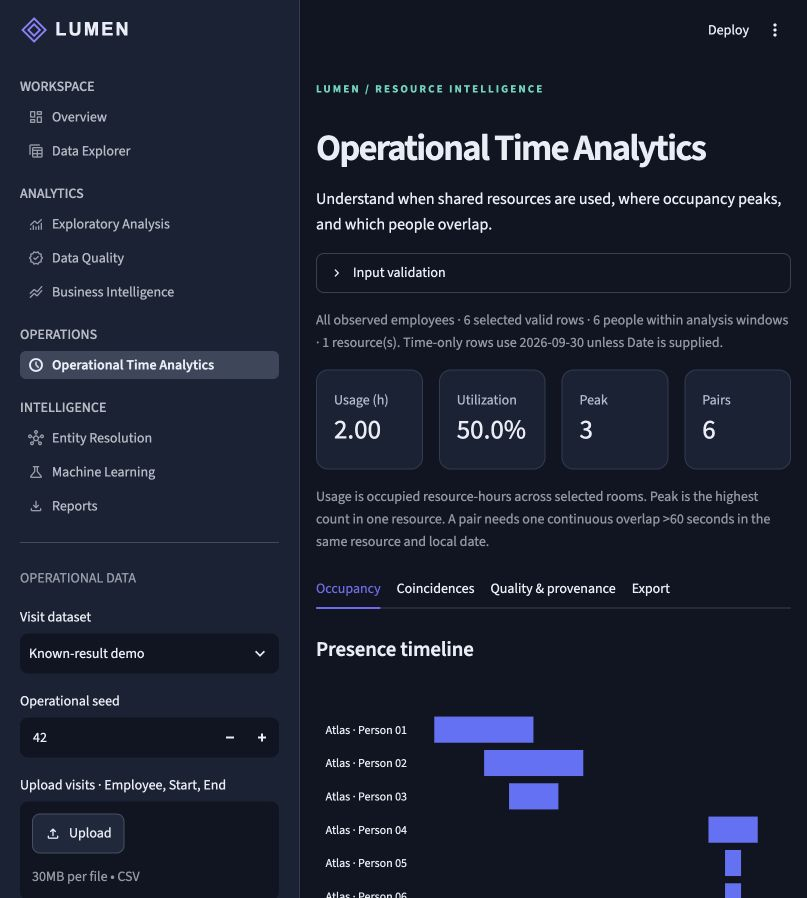
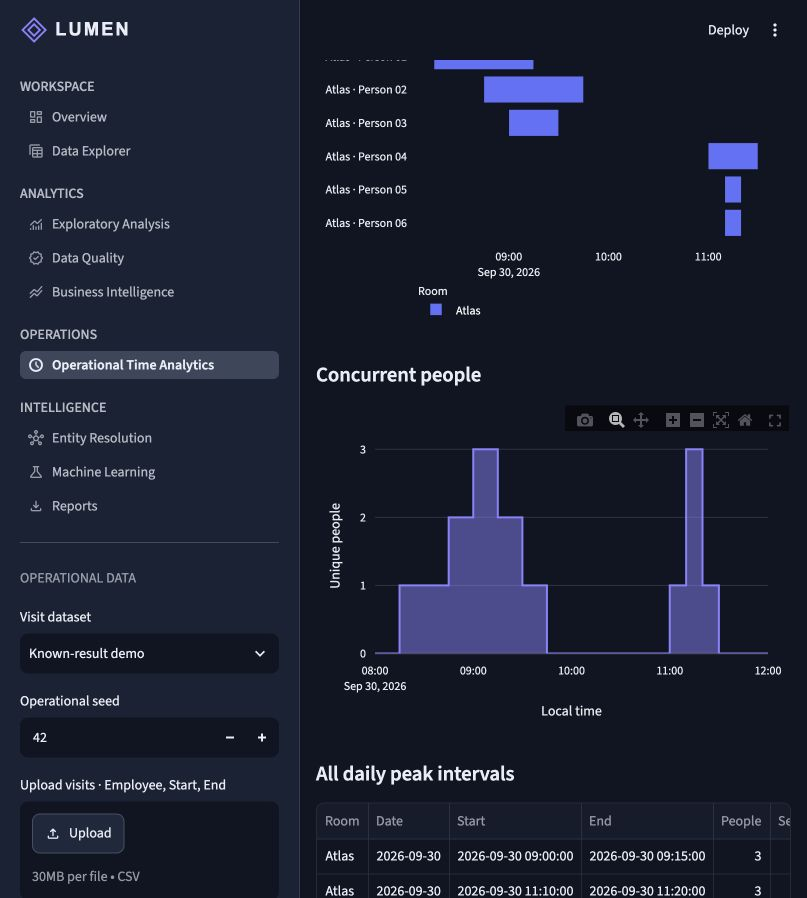

# Operational Time Analytics — local delivery audit

Date: **2026-10-29**. Branch: **feature/operational-time-analytics**. Base: `fd7dae2cb3510856d2f454f24d38da1d349ca08a` on main. Package version remains **0.1.0**. The extension was uploaded to the private feature branch with owner approval after local validation. [Draft review #1](https://github.com/revyalo/lumen-intelligent-mdm-analytics/pull/1) is open. No merge, tag, release or public-visibility change was made.

## Functional outcome

Lumen now has a ninth Streamlit section with a separate operational input context. It accepts strict visit CSVs and original seeded fixtures, validates/quarantines ambiguous rows explicitly, unions same-person intervals with row lineage, calculates unique-person occupancy and every daily peak plateau, provides continuous-threshold contact evidence and tied rankings, and exports full operational evidence.

Availability and capacities are explicit. Zero-visit resource-days are included when observation windows exist; utilization/idle time remain missing otherwise. Employee/date/resource filters are recorded. Identity aliases require a reviewed exact map; the same-scope before/after comparison is exported. Conflicting cross-resource presence is rejected. The existing commercial MDM, BI, ML and data contracts were preserved.

[Complete definitions, architecture and run instructions](README.md). [Initial design/acceptance contract](DESIGN.md). [Files created and changed](FILES.md).

## Executed verification

| Check | Actual result |
|---|---|
| Full regression | **99 passed**, 0 failures/errors/skips, pytest wall time **99.30 seconds**. All **41 existing tests** pass, plus **52 new algorithm/integration tests and 6 new UI tests**. [Sanitized JUnit](test-results.xml). |
| Independent reference | Twelve seeded small interval sets compared against a separate per-second presence reference, checking qualifying pairs, union time, integrated person-time and maxima. Row-order/duplicate invariance also checked. |
| Boundaries | Empty/single input, no contact, exact 60-second cutoff, repeated/subthreshold contacts, nested/adjacent/duplicate/self-overlapping intervals, ties/multiple peaks, invalid times/formats, midnight splits, separate rooms, schedule gaps/clipping, zero-visit windows, capacity, identity conflicts and explicit work budget. |
| UI behavior | Known metrics, actual ZIP generation, selected-population warning, quarantine consent, exact identity map, navigation/state preservation, uploaded-CSV path and multi-day heatmap checked with Streamlit AppTest. |
| Static checks | Ruff passed; Git diff whitespace check passed; pip check found no broken requirements. No dependencies or package-version changes. |
| Notebooks | Both existing notebooks executed in memory: **10 + 12 code cells**, no error outputs; source files were not overwritten. [Record](notebook-check.json). |
| Distribution | Built wheel and installed it into an isolated target in the verified dependency environment. Python `-I` imported the new module from that target, generated a temporal CLI fixture, created a valid operational report and executed all six packaged SQL queries. [Record](wheel-check.json). This is a distribution-content check, not a new cross-platform environment certification. |
| Visual QA | Started the local Streamlit server, opened the new page in a real browser, verified computed metrics/plots and saved actual screenshots. Browser tab and temporary server were closed. |
| Benchmarks | Eight real runs: 100/1,000/10,000/50,000 rows × seeds 42/123, plus independently checked demo expectations. [Raw timings](experiments/performance.csv), [measurement environment](experiments/summary.json), [known-answer check](experiments/demo-check.json). |
| CI definition | Added operational CLI/report smoke checks and small benchmarks; actionlint **v1.7.12 passes**. The workflow was triggered remotely, but the account-level restriction stopped all three jobs before runner startup; no remote tests executed. |
| Publication hygiene | Known secret/personal-path/reference markers, excluded runtime/model/reference artifacts and file-size/ZIP checks scanned locally without findings. Scan is heuristic and screenshots were visually reviewed. No external reference PDF, branding, dataset or copied instructions are included. |

## Measured performance and limits

| Input rows | Seed 42 total measured seconds | Seed 123 total measured seconds |
|---|---:|---:|
| 100 | 0.394 | 0.519 |
| 1,000 | 1.928 | 1.985 |
| 10,000 | 16.561 | 16.688 |
| 50,000 | 35.341 | 35.398 |

Totals include CSV parsing, validation, union/day splitting, occupancy and pair enumeration. They exclude generation/CSV serialization, UI drawing, final aggregate construction and report packaging. The CSV preserves separate timings for each measured stage. These are single local runs per condition, not capacity guarantees or repeated-trial confidence intervals.

The dense 50,000-row inputs generate roughly **1.26 million qualifying evidence segments**. Their measured output-table deep storage estimates are about **508–510 million bytes**, not peak process RAM. This benchmark explicitly raises the comparison budget to **2,000,000**. The default application budget is **1,000,000**; these dense inputs require reducing scope or deliberately changing that API budget. The result is evidence of output growth, not a claim that every 50,000-row upload succeeds with default settings. No large generated input/evidence tables are committed.

## Real screenshots





## Integration decisions

- Retained the existing package layout, dependencies, CLI entry point and Streamlit navigation; added an operational package and page.
- Extracted visual setup from the existing sidebar setup, preserving commercial behavior while avoiding sales/customer controls on the operational page.
- Reused chart/CSV helpers and session-state conventions. Date/resource/employee selections are local to the module.
- Extracted shared deterministic ZIP packaging for both existing and operational evidence reports; existing report contents and tests remain compatible.
- Commercial matching/survivorship assumptions are not generalized into employee identity rules. Exact mapping is separate, explicit and traced.
- Preserved existing notebooks, commercial datasets, analytics/ML/matching modules, dependency declarations and version metadata. Added additive documentation and CI definitions.

## Deliberately outside this delivery

Timezone/DST inference, automatic fuzzy employee merging, predictive ML, distributed/streaming execution, live occupancy sensors, room booking optimization and production authentication/multiuser deployment. Custom business calendars are available through explicit Python observation windows; the UI/CLI offer simple repeated daily hours. Native datetime DataFrames should be serialized to the documented strict CSV contract. All identities are labels, not verified people.

## Git and remaining publication gates

The original main branch stays at the base commit above. The locally verified source commit `c9bbe29ad9a8a5f49a2b8533efebfb0cc67838aa` was pushed with owner approval to the private feature branch. [Actions run 40949509733](https://github.com/revyalo/lumen-intelligent-mdm-analytics/actions/runs/40949509733) was blocked before all three runners started by the account-level restriction. Local passing tests and a valid workflow do not establish Linux/Windows or hosted-CI success. A subsequent documentation-only commit records the upload and blocker, using `[skip ci]` to avoid another identical blocked attempt. The delivered ZIP matches the branch head; application source is unchanged from the tested commit.

A later additive release could be **0.2.0**, after review and successful intended-revision CI, but the official version is unchanged. The private push is authorized and complete. Merge, public visibility and a release/tag require a separate decision.

## Launch and demonstrate

```bash
python -m venv .venv
source .venv/bin/activate                    # Windows: .venv\Scripts\activate
python -m pip install -e ".[dev]"
python -m streamlit run dashboard/app.py
```

Open **Operational Time Analytics**. The default demo computes 2.00 occupied resource-hours, 50% utilization of the supplied 08:00–12:00 window, peak 3 and 6 unique pairs. Enable capacity 2 for 25 minutes above capacity. Choose the identity demo and apply its explicit map; use the quality tab to compare before/after. Try the validation challenge to see quarantine consent. Export → Build operational evidence report creates the complete reproducible ZIP.
